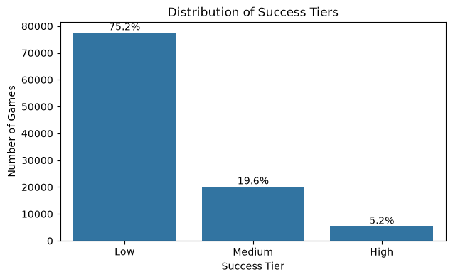

# Steam Game Pre-Release Success Predictor

An end-to-end Machine Learning service that predicts the commercial and player-base success tier (`Low`, `Medium`, or `High`) of a Steam video game **before launch**, using only pre-release store page metadata.

## Table of Contents

- [Problem Description](#problem-description)
- [Project Structure](#project-structure)
- [Dataset & Reproducibility](#dataset--reproducibility)
- [EDA & Modeling Overview](#eda--modeling-overview)
- [Environment Setup & Dependency Management](#environment-setup--dependency-management)
- [Training the Model](#training-the-model)
- [Running the API Locally](#running-the-api-locally)
- [Containerization (Docker)](#containerization-docker)
- [Local Cloud Deployment (Kubernetes)](#local-cloud-deployment-kubernetes)

## Problem Description

Indie studios and game publishers invest significant time and capital before a game ever reaches players, yet post-launch performance on Steam varies drastically across titles. Relying on post-release signals (such as user reviews, concurrent player counts, or playtime) introduces data leakage and cannot help teams make decisions prior to launch.

**How this solution is used:**
- **Pre-release benchmarking:** Developers and publishers can input planned store attributes—pricing, genre/tag positioning, localization coverage, store page completeness, release timing, and market competition—into the REST API to estimate the expected success tier (`Low`, `Medium`, `High`) and class probabilities.
- **Storefront & localization optimization:** Teams can run what-if scenarios (e.g., expanding supported languages, adding Steam achievements/trading cards, or adjusting release month) to see how store metadata shifts predicted tier confidence.

---

## Project Structure

```text
steam-success-predictor/
├── app/
│   ├── __init__.py
│   ├── main.py              # FastAPI application entrypoint & lifespan model loader
│   ├── router.py            # /api/v1/predict endpoint definitions
│   ├── schema.py            # Pydantic v2 request/response validation schemas
│   └── service.py           # Feature engineering & XGBoost inference pipeline
├── docs/
│   ├── feature_importance (XGBoost).png
│   ├── k8s_deployment.png
│   ├── success_tier_distribution.png
│   └── world_cloud.png
├── k8s/
│   ├── deployment.yaml      # Kubernetes Deployment manifest with resource limits & health probe
│   └── service.yaml         # Kubernetes NodePort Service manifest
├── models/
│   ├── best_xgboost.json               # Trained XGBoost multiclass classifier
│   └── preprocessing_artifacts.joblib  # Fitted TF-IDF, TargetEncoder, MultiLabelBinarizers & feature order
├── notebooks/
│   ├── dataset_eda.ipynb    # Exploratory Data Analysis, text frequency/word clouds & feature importance
│   └── train.ipynb          # Model experimentation & hyperparameter tuning
├── .dockerignore
├── .gitignore
├── .python-version
├── Dockerfile
├── predict.py               # Sample HTTP client for testing the inference endpoint
├── pyproject.toml           # Project metadata and dependencies
├── train.py                 # Standalone reproducible training script
└── uv.lock                  # Locked dependency versions
```

---

## Dataset & Reproducibility

This project uses the **Steam Games Dataset** hosted on Kaggle:
- **Source:** [Steam Games Dataset on Kaggle](https://www.kaggle.com/datasets/fronkongames/steam-games-dataset)

### Setup Data Locally
1. Download the dataset archive from Kaggle and extract `games.json`.
2. Place the raw JSON file into the following directory:
   ```bash
   mkdir -p data/raw
   mv /path/to/downloaded/games.json data/raw/games.json
   ```

*(Note: Trained model artifacts are already included in `models/`, so you can run the inference API immediately without retraining, or re-run `train.py` from scratch using the steps below.)*

---

## EDA & Modeling Overview

- **Exploratory Data Analysis (`notebooks/dataset_eda.ipynb`):** Analyzed target tier distribution, missing values, numerical feature ranges, seasonal release competition, text patterns in `short_description` (most frequent terms and word clouds), and post-training feature importances.
- **Feature Engineering (`train.py` & `app/service.py`):**
  - **Numerical & boolean metadata:** `price`, `required_age`, `achievements`, `screenshots_count`, `release_month`, `market_competition`, OS support (`windows`, `mac`, `linux`), and storefront completeness (`has_header_image`, `has_website`, `has_support_url`, `has_support_email`).
  - **High-cardinality categorical encoding:** Smoothed multiclass `TargetEncoder` for `primary_developer` and `primary_publisher`.
  - **Multi-label binarization:** `MultiLabelBinarizer` fitted on top labels for `genres`, `categories`, `tags`, `supported_languages`, and `full_audio_languages`.
  - **NLP features:** `TfidfVectorizer(max_features=300, stop_words="english")` applied to `short_description`.
- **Model Selection & Tuning (`notebooks/train.ipynb`):** Trained and tuned multiple model families—**Logistic Regression**, **Random Forest**, and **XGBoost**—using class-balanced sample weights and a fixed random seed (`RANDOM_STATE = 42`). The best-performing tuned **XGBoost** model was exported to `train.py`.

### Key Visual Insights

**Target Class Distribution (`success_tier`)**



**Most Frequent Terms in Game Descriptions**


**Top Feature Importances (Tuned XGBoost)**

.png>)

---

## Environment Setup & Dependency Management

This project uses Python **3.12+** and [`uv`](https://docs.astral.sh/uv/) for fast, deterministic dependency and virtual environment management.

1. **Clone the repository:**
   ```bash
   git clone [https://github.com/](https://github.com/)<your-username>/steam-success-predictor.git
   cd steam-success-predictor
   ```

2. **Install `uv` (if not already installed):**
   ```bash
   curl -LsSf [https://astral.sh/uv/install.sh](https://astral.sh/uv/install.sh) | sh
   ```

3. **Create the virtual environment and install locked dependencies:**
   ```bash
   uv sync --frozen
   ```

4. **Activate the virtual environment:**
   - **Linux / macOS:**
     ```bash
     source .venv/bin/activate
     ```
   - **Windows (PowerShell):**
     ```powershell
     .venv\Scripts\Activate.ps1
     ```

---

## Training the Model

The training pipeline reads the cleaned dataset produced by the preprocessing step in `notebooks/dataset_eda.ipynb`. To reproduce feature engineering, model training, and artifact serialization (`models/best_xgboost.json` and `models/preprocessing_artifacts.joblib`) from scratch:

1. **Run data preprocessing:** Ensure `data/raw/games.json` is in place, then open `notebooks/dataset_eda.ipynb` and execute all cells to generate the processed dataset in `data/processed/`.
2. **Train and export the model:**
   ```bash
   uv run python train.py
   ```

---

## Running the API Locally

Start the FastAPI server from the project root:

```bash
uv run fastapi run app/main.py --host 0.0.0.0 --port 8000
```

- Interactive Swagger documentation is available at `http://127.0.0.1:8000/docs`.
- Health check endpoint is available at `GET http://127.0.0.1:8000/health`.

### Testing Inference

In a second terminal, run the provided test script:

```bash
uv run python predict.py
```

Or send a `POST` request directly using `curl`:

```bash
curl -X POST "[http://127.0.0.1:8000/api/v1/predict](http://127.0.0.1:8000/api/v1/predict)" \
  -H "Content-Type: application/json" \
  -d '{
    "price": 24.99,
    "required_age": 0,
    "achievements": 49,
    "screenshots_count": 21,
    "release_month": 9,
    "market_competition": 520,
    "windows": true,
    "mac": true,
    "linux": false,
    "has_header_image": true,
    "has_website": true,
    "has_support_url": true,
    "has_support_email": true,
    "primary_developer": "Supergiant Games",
    "primary_publisher": "Supergiant Games",
    "short_description": "Defy the god of the dead as you hack and slash out of the Underworld in this rogue-like dungeon crawler.",
    "genres": ["Action", "Indie", "RPG"],
    "categories": ["Single-player", "Steam Achievements", "Full controller support"],
    "tags": ["Action Roguelike", "Roguelike", "Hack and Slash", "Mythology", "Great Soundtrack"],
    "supported_languages": ["English", "French", "German", "Spanish - Spain", "Russian", "Japanese"],
    "full_audio_languages": ["English"]
  }'
```

**Example Response (`200 OK`):**

```json
{
  "success_tier": "High",
  "probabilities": {
    "Low": 0.0023,
    "Medium": 0.026,
    "High": 0.9717
  },
  "summary": "Predicted High success tier with 97.2% confidence."
}
```

---

## Containerization (Docker)

The service is packaged using a slim Python 3.12 Docker image (`Dockerfile`) with `libgomp1` for XGBoost runtime support and `uv` for reproducible dependency installation.

1. **Build the Docker image:**
   ```bash
   docker build -t steam-success-predictor:v1 .
   ```

2. **Run the container:**
   ```bash
   docker run --rm -p 8000:8000 steam-success-predictor:v1
   ```

3. **Verify the containerized service:**
   ```bash
   uv run python predict.py
   ```

---

## Local Cloud Deployment (Kubernetes)

Kubernetes manifests in `k8s/` deploy the containerized API as a `Deployment` exposed via a `NodePort` `Service` (port `30080`).

1. **Create a local Kubernetes cluster using `kind`:**
   ```bash
   kind create cluster --name steam-predictor
   ```

2. **Load the local Docker image into the cluster:**
   ```bash
   kind load docker-image steam-success-predictor:v1 --name steam-predictor
   ```

3. **Apply the Kubernetes manifests and verify pod readiness:**
   ```bash
   kubectl apply -f k8s/
   kubectl get pods -w
   ```

4. **Forward the service port to localhost and test the endpoint:**
   ```bash
   kubectl port-forward service/steam-predictor-service 8000:8000
   ```
   In another terminal:
   ```bash
   uv run python predict.py
   ```

### Deployment Verification

