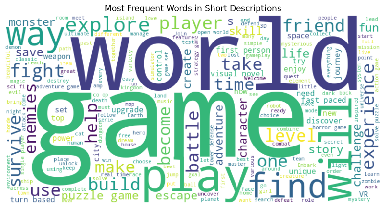
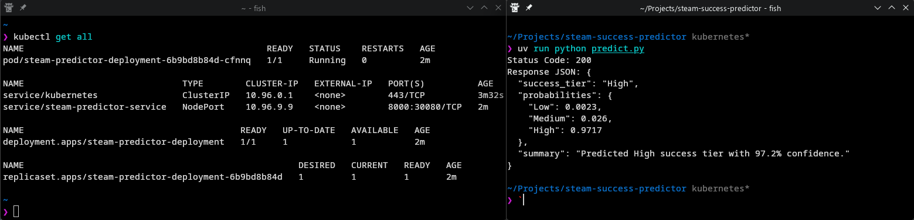

# Steam Game Pre-Release Success Predictor

An end-to-end Machine Learning service that predicts the commercial and player-base success tier (`Low`, `Medium`, or `High`) of a Steam video game **before launch**, using only pre-release store page metadata and strictly prior studio history.

## Table of Contents

- [Problem Description](#problem-description)
- [Project Structure](#project-structure)
- [Dataset & Reproducibility](#dataset--reproducibility)
- [EDA & Modeling Overview](#eda--modeling-overview)
- [Environment Setup & Dependency Management](#environment-setup--dependency-management)
- [Training the Model](#training-the-model)
- [Running Locally (API & Web UI)](#running-locally-api--web-ui)
- [Containerization (Docker & Docker Compose)](#containerization-docker--docker-compose)
- [Local Cloud Deployment (Kubernetes)](#local-cloud-deployment-kubernetes)

## Problem Description

Indie studios and game publishers invest significant time and capital before a game ever reaches players, yet post-launch performance on Steam varies drastically across titles. Relying on post-release signals (such as user reviews, concurrent player counts, playtime, user tags, or post-release Steam categories) introduces data leakage and cannot help teams make decisions prior to launch.

**How this solution is used:**
- **Pre-release benchmarking:** Developers and publishers can input planned store attributes—pricing, studio track record, genre/category positioning, localization coverage, store page completeness, and release timing—into the REST API or Streamlit web interface to estimate the expected success tier (`Low`, `Medium`, `High`), calibrated class probabilities, and the chance of reaching 20k+ owners.
- **Storefront & localization optimization:** Teams can run what-if scenarios (e.g., expanding supported languages, adding Steam achievements/cloud support, or adjusting release timing) to observe how store metadata shifts predicted tier confidence.

---

## Project Structure

```text
steam-success-predictor/
├── .streamlit/
│   └── config.toml               # Streamlit dark theme configuration
├── app/
│   ├── __init__.py
│   ├── deps.py                   # FastAPI dependencies for loaded model & artifacts (503 guard)
│   ├── main.py                   # FastAPI application entrypoint, lifespan loader & /health probe
│   ├── router.py                 # /steam-predictor/predict and /steam-predictor/metadata endpoints
│   ├── schema.py                 # Pydantic v2 request/response validation schemas
│   └── service.py                # Feature engineering, studio history lookup & calibrated inference
├── docs/
│   ├── feature_importance(XGBoost).png
│   ├── k8s_deployment.png
│   ├── success_tier_distribution.png
│   └── word_cloud.png
├── k8s/
│   ├── deployment.yaml           # Kubernetes Deployment for FastAPI backend (readiness & liveness probes)
│   ├── service.yaml              # Internal ClusterIP Service for FastAPI backend
│   ├── ui-deployment.yaml        # Kubernetes Deployment for Streamlit UI
│   └── ui-service.yaml           # NodePort Service (30851) for Streamlit UI
├── models/
│   ├── best_xgboost.json               # Trained XGBoost multiclass classifier
│   └── preprocessing_artifacts.joblib  # Fitted TF-IDF, MultiLabelBinarizers, studio history & calibration temp
├── notebooks/
│   ├── dataset_eda.ipynb         # Initial EDA, text frequency/word clouds & feature importance
│   ├── dataset_eda_v2.ipynb      # Updated EDA & leakage analysis
│   └── train.ipynb               # Baseline model comparison & hyperparameter experimentation
├── .dockerignore
├── .gitignore
├── .python-version
├── Dockerfile.api                # Container image for FastAPI inference service
├── Dockerfile.ui                 # Lightweight container image for Streamlit web UI
├── docker-compose.yml            # Multi-container orchestration (API + UI with healthcheck)
├── predict.py                    # Sample HTTP client for testing the inference endpoint
├── prepare_data.py               # Reproducible raw-to-parquet data cleaning pipeline
├── pyproject.toml                # Project metadata and dependencies
├── train.py                      # Standalone reproducible training, temporal evaluation & calibration script
├── ui.py                         # Interactive Streamlit web interface
└── uv.lock                       # Locked dependency versions
```

---

## Dataset & Reproducibility

This project uses the **Steam Games Dataset** hosted on Kaggle:
- **Source:** [Steam Games Dataset on Kaggle](https://www.kaggle.com/datasets/fronkongames/steam-games-dataset)

### Setup Data Locally
1. Download the dataset archive from Kaggle and extract `games.json`.
2. Place the raw JSON file into the following directory:
   ```bash
   mkdir -p data/raw
   mv /path/to/downloaded/games.json data/raw/games.json
   ```

*(Note: Trained model artifacts are already included in `models/`, so the inference API and UI can be run immediately without retraining, or reproduced from scratch using the steps below.)*

---

## EDA & Modeling Overview

- **Exploratory Data Analysis (`notebooks/dataset_eda.ipynb`, `notebooks/dataset_eda_v2.ipynb`):** Analyzed target tier distribution (`Low`: `<20k`, `Medium`: `20k–100k`, `High`: `100k+` estimated owners), missing values, numerical ranges, text patterns in `short_description`, and post-release leakage sources.
- **Data Cleaning (`prepare_data.py`):** Removes post-release columns, unreleased `0 - 0` rows, and incomplete `2025–2026` releases; strips post-release and retroactive Steam categories (`Steam Trading Cards`, `Profile Features Limited`, `SteamVR Collectibles`, `Steam Timeline`, and May-2025 accessibility categories). Retains all matured releases (`1997–2024`, 86,335 games) so full studio history is available before slicing the `2021–2024` training window (46,947 games).
- **Feature Engineering (`train.py` & `app/service.py`):**
  - **Numerical, platform & storefront metadata:** `price`, `required_age`, `achievements`, `screenshots_count`, `release_month`, OS support (`windows`, `mac`, `linux`), storefront completeness (`has_header_image`, `has_website`, `has_support_url`, `has_support_email`), plus derived pre-release features (`is_free`, `log_price`, language/genre/category/platform counts, `store_completeness_score`, `is_self_published`, description length/word count, and cyclical `release_month` sin/cos).
  - **Strictly causal studio history:** Prior developer and publisher release counts, `20k+`/`High` hit counts, raw rates, and Bayesian-smoothed success rates (`m = 5.0`), computed strictly from earlier year-months with per-game deduplication across `1997–2024`.
  - **Multi-label binarization:** `MultiLabelBinarizer` fitted on `genres`, `categories`, and top-30 `supported_languages` and `full_audio_languages`.
  - **NLP features:** `TfidfVectorizer(max_features=500, ngram_range=(1, 2), min_df=10, sublinear_tf=True, stop_words="english")` applied to `short_description`.
- **Temporal Validation, Tuning & Calibration (`train.py`):**
  - Uses time-decayed sample weights (`2021: 0.4`, `2022: 0.6`, `2023: 0.8`, `2024: 1.0`) and an Optuna-tuned **XGBoost** classifier (`373` trees, `tree_method="hist"`, `RANDOM_STATE = 42`).
  - Evaluated on an untouched **2024 temporal holdout** (trained on `2021–2023`, temperature scaling fitted out-of-time on `2023`):
    - **LogLoss:** `0.4095`
    - **Brier Score:** `0.2183`
    - **Macro ROC-AUC:** `0.7969` (`Low`: `0.7909`, `Medium`: `0.7210`, `High`: `0.8787`)
  - Refits the final production model on `2021–2024` with out-of-time temperature scaling (`T = 0.7562`) and full `1997–2024` studio history lookups.

### Key Visual Insights

**Target Class Distribution (`success_tier`)**


**Most Frequent Terms in Game Descriptions**



**Top Feature Importances (Tuned XGBoost)**

.png>)

---

## Environment Setup & Dependency Management

This project uses Python **3.12+** and [`uv`](https://docs.astral.sh/uv/) for fast, deterministic dependency and virtual environment management.

1. **Clone the repository:**
   ```bash
   git clone https://github.com/<your-username>/steam-success-predictor.git
   cd steam-success-predictor
   ```

2. **Install `uv` (if not already installed):**
   ```bash
   curl -LsSf https://astral.sh/uv/install.sh | sh
   ```

3. **Create the virtual environment and install locked dependencies:**
   ```bash
   uv sync --frozen
   ```

4. **Activate the virtual environment:**
   - **Linux / macOS:**
     ```bash
     source .venv/bin/activate
     ```
   - **Windows (PowerShell):**
     ```powershell
     .venv\Scripts\Activate.ps1
     ```

---

## Training the Model

To reproduce data preprocessing, temporal validation, probability calibration, and artifact export (`models/best_xgboost.json` and `models/preprocessing_artifacts.joblib`) from scratch:

1. **Prepare the processed dataset** (requires `data/raw/games.json`):
   ```bash
   uv run python prepare_data.py
   ```
2. **Train, evaluate, calibrate, and export the model:**
   ```bash
   uv run python train.py
   ```

---

## Running Locally (API & Web UI)

1. **Start the FastAPI backend** from the project root:
   ```bash
   uv run fastapi run app/main.py --host 0.0.0.0 --port 8000
   ```
   - Interactive Swagger documentation: `http://127.0.0.1:8000/docs`
   - Health check endpoint (`200 OK` when ready, `503` otherwise): `GET http://127.0.0.1:8000/health`
   - Known model metadata for UI dropdowns: `GET http://127.0.0.1:8000/steam-predictor/metadata`

2. **Start the Streamlit web interface** in a second terminal:
   ```bash
   uv run streamlit run ui.py
   ```
   - Open `http://127.0.0.1:8501` in a browser.

### Testing Inference via CLI

Run the provided test script:

```bash
uv run python predict.py
```

Or send a `POST` request directly using `curl`:

```bash
curl -X POST "http://127.0.0.1:8000/steam-predictor/predict" \
  -H "Content-Type: application/json" \
  -d '{
    "price": 24.99,
    "required_age": 0,
    "achievements": 49,
    "screenshots_count": 21,
    "release_month": 9,
    "windows": true,
    "mac": true,
    "linux": false,
    "has_header_image": true,
    "has_website": true,
    "has_support_url": true,
    "has_support_email": true,
    "developers": ["Supergiant Games"],
    "publishers": ["Supergiant Games"],
    "short_description": "Defy the god of the dead as you hack and slash out of the Underworld in this rogue-like dungeon crawler from the creators of Bastion, Transistor, and Pyre.",
    "genres": ["Action", "Indie", "RPG"],
    "categories": ["Single-player", "Steam Achievements", "Full controller support", "Steam Cloud", "Remote Play on TV"],
    "supported_languages": ["English", "French", "Italian", "German", "Spanish - Spain", "Korean", "Polish", "Portuguese - Brazil", "Russian", "Simplified Chinese", "Japanese"],
    "full_audio_languages": ["English"]
  }'
```

**Example Response (`200 OK`):**

```json
{
  "success_tier": "High",
  "prob_20k_plus": 0.958,
  "probabilities": {
    "Low": 0.0421,
    "Medium": 0.0871,
    "High": 0.8709
  },
  "summary": "Most likely tier: High (87.1%). Estimated chance of reaching 20k+ owners: 95.8%."
}
```

---

## Containerization (Docker & Docker Compose)

The backend API (`Dockerfile.api`) and Streamlit frontend (`Dockerfile.ui`) are packaged as separate slim Python 3.12 containers and wired together via `docker-compose.yml` (the UI waits for the API `/health` check before starting).

1. **Build and start both services with Docker Compose:**
   ```bash
   docker compose up --build
   ```
   - Web UI: `http://127.0.0.1:8501`
   - FastAPI backend: `http://127.0.0.1:8000/docs`

2. **Stop containers:**
   ```bash
   docker compose down
   ```

3. **Build images individually (optional):**
   ```bash
   docker build -f Dockerfile.api -t steam-success-predictor:v1 .
   docker build -f Dockerfile.ui -t steam-success-predictor-ui:v1 .
   ```

---

## Local Cloud Deployment (Kubernetes)

Kubernetes manifests in `k8s/` deploy both the FastAPI backend (internal `ClusterIP` service with readiness/liveness probes on `/health`) and the Streamlit UI (`NodePort` service on port `30851` with probes on `/_stcore/health`, communicating with the backend via internal Kubernetes DNS `http://steam-predictor-service:8000/steam-predictor/`).

1. **Create a local Kubernetes cluster using `kind`:**
   ```bash
   kind create cluster --name steam-predictor
   ```

2. **Load both local Docker images into the cluster:**
   ```bash
   kind load docker-image steam-success-predictor:v1 --name steam-predictor
   kind load docker-image steam-success-predictor-ui:v1 --name steam-predictor
   ```

3. **Apply the Kubernetes manifests and verify pod readiness:**
   ```bash
   kubectl apply -f k8s/
   kubectl get pods -w
   ```

4. **Forward the UI service port to localhost:**
   ```bash
   kubectl port-forward service/steam-predictor-ui-service 8501:8501
   ```
   Open `http://127.0.0.1:8501` in a browser.

### Deployment Verification


